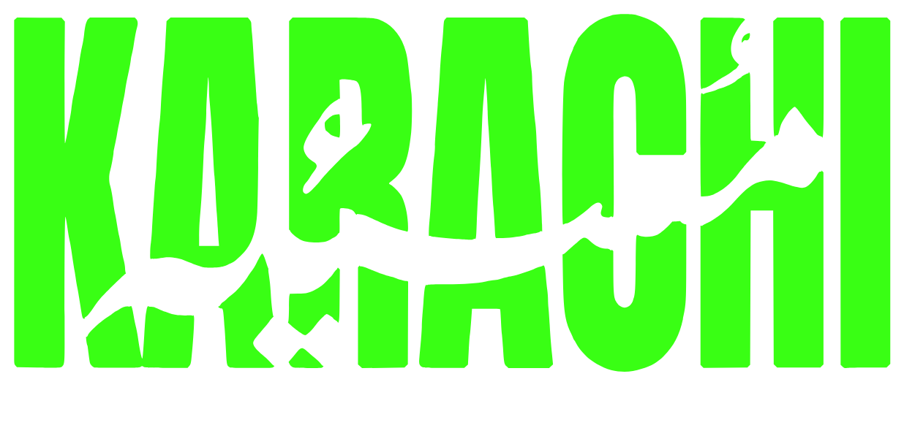
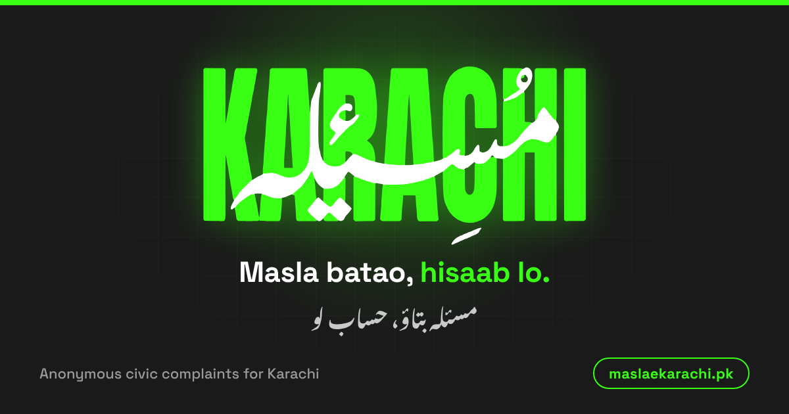

<div align="center">



# MASLA-E-KARACHI

### Karachi's problems, reported anonymously. Heard loudly.

An anonymous civic-complaint platform for the people of Karachi.<br/>
This repository is its official **landing website**.

<br/>

[](https://buildsbyaliyan.github.io/masla-e-karachi-landing/)
[](https://maslaekarachi.pk)


<br/>

[**Overview**](#-overview) ·
[**Highlights**](#-highlights) ·
[**Pages**](#-pages) ·
[**Quick Start**](#-quick-start) ·
[**Customize**](#-customize) ·
[**Deploy**](#-deploy) ·
[**Credits**](#-credits)

<br/>



</div>

<br/>

---

## ◼ Overview

Every day, Karachi residents face broken roads, water shortages, garbage piles, dead streetlights and more. Most of these issues never get reported, because people are unsure where to go, who to call, or whether they will be safe doing so.

**Masla-e-Karachi** is built to change that: a platform where citizens can report local civic issues **anonymously**, in a clear and structured way.

This repository contains the **landing website** that introduces the project, explains how it works, and answers the questions people ask first. The full platform is under active development and lives at [maslaekarachi.pk](https://maslaekarachi.pk).

| | |
|---|---|
| **Project** | Masla-e-Karachi, anonymous civic complaints for Karachi |
| **This repo** | Public landing and information website |
| **Live site** | [buildsbyaliyan.github.io/masla-e-karachi-landing](https://buildsbyaliyan.github.io/masla-e-karachi-landing/) |
| **Platform** | [maslaekarachi.pk](https://maslaekarachi.pk) (under development) |
| **Language** | English |
| **Theme** | Dark charcoal with neon green accents |

<br/>

## ◼ Highlights

| | Feature | Details |
|:--:|---|---|
| ⚡ | **Zero build step** | Plain HTML, CSS and vanilla JavaScript. No framework, no npm, no bundler. Open it and it runs. |
| 🔒 | **Strict security posture** | Content-Security-Policy ready. No inline scripts, no inline styles, no CDN calls. Everything is self-hosted. |
| 🎨 | **Design system** | One source of truth for colors, spacing and type in `variables.css`. Consistent from the hero to the footer. |
| 🔤 | **Self-hosted fonts** | Inter, Space Grotesk and DM Mono ship with the repo (SIL OFL 1.1). No third-party font requests. |
| 📝 | **Single-file content** | All site copy lives in one file, `docs/lang/en.json`. Edit the text without touching HTML. |
| 🔎 | **SEO and sharing ready** | Canonical URLs, Open Graph tags, JSON-LD, `sitemap.xml`, `robots.txt` and a full favicon set. |
| 📱 | **Responsive** | Built to hold up from small phones to wide desktop screens. |
| 🧰 | **Maintenance tooling** | Python helpers to regenerate favicons, apply author metadata and find unused assets. |

<br/>

## ◼ Pages

| Page | File | Purpose |
|---|---|---|
| **Home** | `index.html` | What Masla-e-Karachi is and why it exists |
| **How it works** | `how-it-works.html` | The reporting flow, step by step |
| **Privacy** | `privacy.html` | How anonymity is protected |
| **FAQ** | `faq.html` | Answers to the most common questions |
| **Terms** | `terms.html` | Rules of use |
| **404** | `404.html` | Branded not-found page |

<br/>

## ◼ Tech Stack

```text
Markup      HTML5
Styling     CSS3  (custom properties, modular files bundled by a build script)
Behavior    Vanilla JavaScript (ES6+)
Content     JSON  (docs/lang/en.json)
Hosting     GitHub Pages  (served from /docs on main)
Tooling     Python 3  (favicons, metadata, cleanup)
```

<br/>

## ◼ Project Structure

```text
masla-e-karachi-landing/
│
├── docs/                      ← the entire website (GitHub Pages serves this)
│   ├── *.html                 6 pages
│   ├── css/                   variables · base · layout · components · pages
│   ├── js/                    config · i18n · main · counter · faq · base-404
│   ├── lang/en.json           all site text lives here
│   ├── assets/                fonts · images · favicons
│   └── robots.txt · sitemap.xml · humans.txt · .nojekyll
│
├── tools/                     helper scripts (not deployed)
│   ├── css-source/            modular CSS sources
│   ├── css-manifest/          bundle manifests
│   ├── build_css.py
│   ├── make_favicons.py
│   ├── apply_author_meta.py
│   ├── find_unused.py
│   └── developer.json
│
├── project-reference/         project context files (not deployed)
├── LICENSE
└── README.md
```

<br/>

## ◼ Quick Start

No installation needed. Just serve the `docs` folder.

```bash
# 1. Clone
git clone https://github.com/BuildsByAliyan/masla-e-karachi-landing.git
cd masla-e-karachi-landing

# 2. Serve locally (Python 3)
python3 -m http.server 8000 -d docs
```

Then open **http://localhost:8000** in your browser.

> On Windows, if `python3` is not recognized, use `python -m http.server 8000 -d docs`.

<br/>

## ◼ Customize

<details>
<summary><b>Links, email and site settings</b></summary>
<br/>

Edit `docs/js/config.js`. It holds the platform link, site URL, contact email and developer info.

```js
CONTACT_EMAIL: 'hello@example.pk'
```

If the email is left empty, the FAQ shows "Contact email will be added at launch".

</details>

<details>
<summary><b>Text and copy</b></summary>
<br/>

All text lives in **`docs/lang/en.json`**. The HTML already contains the English text, and the JSON keeps it in sync.

To add a new piece of text, put `data-i18n="your.key"` on the HTML element and add `your.key` to `en.json`.

</details>

<details>
<summary><b>Colors, fonts and spacing</b></summary>
<br/>

Edit `docs/css/variables.css`. Every color, font and spacing token is defined there.

</details>

<details>
<summary><b>Layout and component design</b></summary>
<br/>

Edit `docs/css/layout.css`, `components.css` or `pages.css`. These are bundle files, and each section is marked with a `/* >>> ... */` comment so it is easy to find.

</details>

<details>
<summary><b>Project rules (important)</b></summary>
<br/>

The site is built for a strict Content-Security-Policy, so please follow these rules:

- No inline `style=""` attributes
- No inline `<script>` blocks
- No CDN or third-party requests
- Keep every path **relative**

</details>

<br/>

## ◼ Developer Tools

Run all scripts from the project root:

```bash
python3 tools/<script>.py docs
```

| Script | What it does |
|---|---|
| `make_favicons.py` | Generates every favicon size from `tools/favicon-source/favicon.png` (needs Pillow) |
| `apply_author_meta.py` | Applies author meta tags and JSON-LD `sameAs` links from `developer.json` |
| `find_unused.py` | Reports unused files, CSS classes and language keys. It never deletes anything |
| `build_css.py` | Bundles the modular CSS sources into the final CSS files |
| `developer.json` | Developer name and links. Keep it in sync with `DEVELOPER` in `docs/js/config.js` |

<br/>

## ◼ Deploy

The site is deployed with **GitHub Pages** straight from this repository.

1. Push the repo to GitHub
2. Go to **Settings → Pages**
3. Set **Source** to *Deploy from a branch*, **Branch** to `main`, and **Folder** to `/docs`
4. Save. The site goes live at `https://<username>.github.io/<repo-name>/`

<details>
<summary><b>Changing the username or repository name</b></summary>
<br/>

Update the old URL to the new one in:

- `docs/*.html` (canonical, `og:url`, `og:image`, JSON-LD)
- `docs/sitemap.xml`
- `docs/robots.txt`
- `SITE_URL` in `docs/js/config.js`

</details>

<details>
<summary><b>Using a custom domain</b></summary>
<br/>

Create `docs/CNAME` containing only the domain on a single line, with no `https://` and no blank lines.

If you are not using a custom domain, remove `docs/CNAME`. An empty or wrong CNAME file can break GitHub Pages.

</details>

<br/>

## ◼ Roadmap

- [x] Landing website live on GitHub Pages
- [x] Self-hosted fonts and a CSP-friendly codebase
- [x] SEO, Open Graph and favicon setup
- [ ] Full platform launch at [maslaekarachi.pk](https://maslaekarachi.pk)
- [ ] Public contact email

<br/>

## ◼ Contributing

Suggestions and bug reports are welcome. Open an [issue](https://github.com/BuildsByAliyan/masla-e-karachi-landing/issues) describing what you found or what you would like to see. If you want to send a pull request, please keep to the project rules listed under **Customize**.

<br/>

## ◼ Credits

**Design and development: Aliyan Saleem**

[](https://portfolio-aliyan-saleem.vercel.app)
[](https://www.linkedin.com/in/aliyan-saleem-02a596378/)
[](https://github.com/BuildsByAliyan)
[](https://www.youtube.com/@apexmotive.official)
[](https://www.instagram.com/creativestudi0.pk_/)

**Fonts:** Inter, Space Grotesk and DM Mono, licensed under the SIL Open Font License 1.1. License texts are in `docs/assets/fonts/licenses/`.

<br/>

---

<div align="center">

**Built in Karachi, for Karachi.**

<sub>© Masla-e-Karachi · Released under the license in the [LICENSE](LICENSE) file</sub>

</div>
