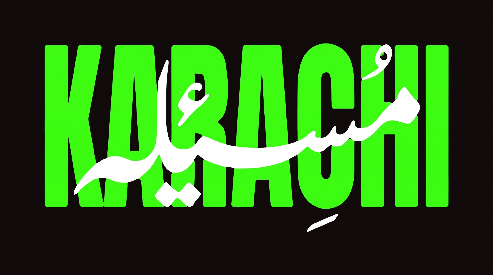
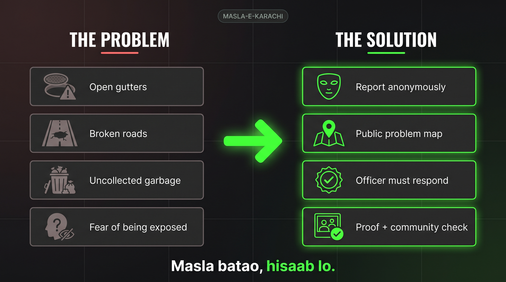
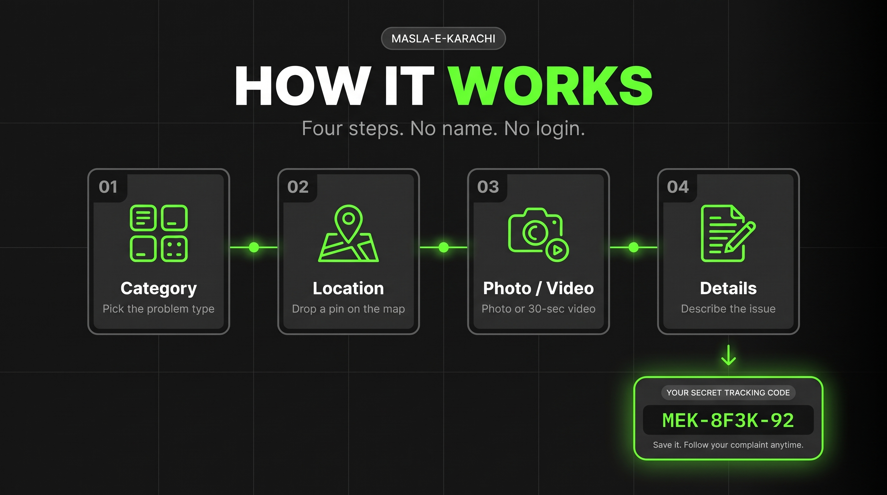
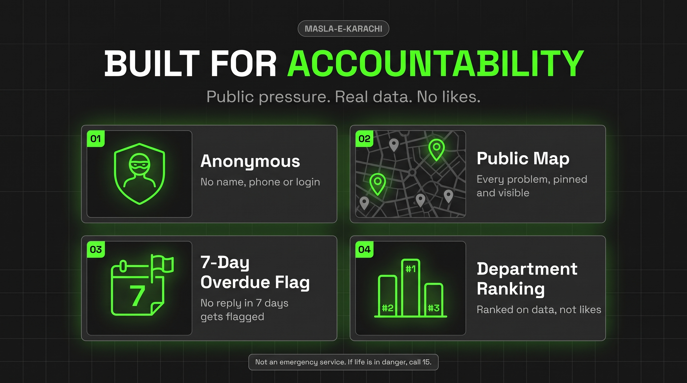
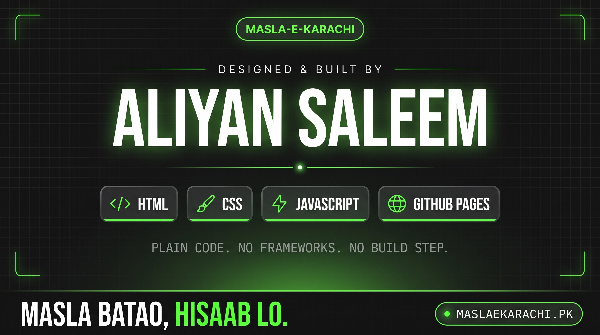

<div align="center">



<br><br>

# MASLA-E-KARACHI
### Masla batao, <ins>hisaab lo.</ins>

**Karachi ke shehri masle report karo — anonymously. Public map par. Bina login ke.**

<br>

[](https://buildsbyaliyan.github.io/masla-e-karachi-landing/)
[](https://maslaekarachi.pk)
[](#-yeh-repo-kya-hai)


<br>

[**Yeh repo kya hai**](#-yeh-repo-kya-hai) &nbsp;·&nbsp;
[**Problem → Solution**](#-problem--solution) &nbsp;·&nbsp;
[**How it works**](#-how-it-works) &nbsp;·&nbsp;
[**Accountability**](#-built-for-accountability) &nbsp;·&nbsp;
[**Quick start**](#-quick-start) &nbsp;·&nbsp;
[**Edit guide**](#-kaise-edit-karein) &nbsp;·&nbsp;
[**Deploy**](#-deploy-github-pages) &nbsp;·&nbsp;
[**Credits**](#-credits)

</div>

<br>

---

## 📍 Yeh repo kya hai

Masla-e-Karachi ka **introduction (landing) website**: ek anonymous platform jahan Karachi ke log shehri masle report kar sakein.

> [!NOTE]
> Yeh repo **sirf landing website** hai. Asli platform abhi **under development** hai — [maslaekarachi.pk](https://maslaekarachi.pk).

| | |
| :-- | :-- |
| 🌐 **Landing site** | [buildsbyaliyan.github.io/masla-e-karachi-landing](https://buildsbyaliyan.github.io/masla-e-karachi-landing/) |
| 🚀 **Asli platform** | [maslaekarachi.pk](https://maslaekarachi.pk) |
| 🧱 **Stack** | Plain HTML + CSS + vanilla JavaScript |
| 🚫 **Nahi hai** | Koi framework, npm ya build step |
| 🗣️ **Language** | Sirf English |
| 🎨 **Theme** | Dark charcoal + neon green |

**Pages:** `index.html` (Home) · `how-it-works.html` · `privacy.html` · `faq.html` · `terms.html` · `404.html`

<br>

## ⚡ Problem → Solution

<div align="center">

</div>

<br>

Karachi ke masle har roz nazar aate hain — par shikayat karne walay ko dar hota hai ke woh expose ho jayega. Masla-e-Karachi yeh dar khatam karta hai: **naam nahi, login nahi, bas masla aur proof.**

<br>

## 🧭 How it works

<div align="center">

</div>

<br>

| Step | Kya karna hai |
| :-: | :-- |
| **01** | **Category** — masle ki type chuno |
| **02** | **Location** — map par pin lagao |
| **03** | **Photo / Video** — photo ya 30-second ki video |
| **04** | **Details** — masla likh kar batao |

Submit karte hi aapko ek **secret tracking code** milta hai (jaise `MEK-8F3K-92`). Isay save karo aur kisi bhi waqt apni complaint follow karo.

<br>

## 🔒 Built for accountability

<div align="center">

</div>

<br>

| | Feature | Matlab |
| :-: | :-- | :-- |
| 🥷 | **Anonymous** | Naam, phone ya login nahi chahiye |
| 🗺️ | **Public Map** | Har masla pin hua aur sab ko nazar aata hai |
| 🚩 | **7-Day Overdue Flag** | 7 din tak jawab nahi aaya to flag lag jata hai |
| 🏆 | **Department Ranking** | Ranking data par, likes par nahi |

> [!WARNING]
> Yeh **emergency service nahi** hai. Agar jaan khatray mein ho to **15** par call karo.

<br>

---

## 🚀 Quick start

```bash
python3 -m http.server 8000 -d docs
```

Phir browser mein **http://localhost:8000** kholo. Bas — install ya build kuch nahi.

<br>

## 📁 Folder structure

```text
masla-e-karachi-landing/
├── docs/                    ← poori website (GitHub Pages yahin se chalta hai)
│   ├── *.html               6 pages
│   ├── css/                 variables, base, layout, components, pages (5 files, bundle ho chuki)
│   ├── js/                  config, i18n (text loader), main, counter, faq, base-404
│   ├── lang/en.json         saara text — sirf yehi ek file
│   ├── assets/              fonts, images, favicons
│   └── humans.txt · robots.txt · sitemap.xml · .nojekyll
├── tools/                   helper scripts, developer.json, favicon source (deploy nahi hote)
└── project-reference/       project ki context files (deploy nahi hoti)
```

<br>

## 🔧 Kaise edit karein

| Kya badalna hai | Kahan |
| :-- | :-- |
| 🔗 **Links aur settings** | `docs/js/config.js` — asli website ka link, contact email, site URL, developer info |
| ✉️ **Contact email** | `docs/js/config.js` mein `CONTACT_EMAIL: 'hello@example.pk'` likho. Khali rahe to FAQ par *"Contact email will be added at launch"* dikhta hai |
| 📝 **Text** | `docs/lang/en.json` (sirf yeh ek file) |
| 🎨 **Colors, fonts, spacing** | `docs/css/variables.css` |
| 🧩 **Design** | `docs/css/layout.css`, `components.css`, `pages.css` — har hissa `/* >>> ... */` se alag nazar aata hai |

<details>
<summary><b>📝 Text edit karne ka tareeqa (i18n)</b></summary>

<br>

HTML mein English text pehle se likha hota hai; JSON se wahi text update hota hai.

Nayi key lagani ho to:

1. HTML mein `data-i18n="key"` lagao
2. Wohi `key` `docs/lang/en.json` mein dalo

</details>

> [!IMPORTANT]
> **Rules (Content-Security-Policy):** inline `style=""`, inline `<script>` aur CDN **mana** hain. Sab paths **relative** rakho.

<br>

## 🧰 Tools

Helper scripts `tools/` mein hain. Chalane ka tareeqa (project root se):

```bash
python3 tools/<script>.py docs
```

| File | Kaam |
| :-- | :-- |
| `make_favicons.py` | `tools/favicon-source/favicon.png` se saare favicon sizes banata hai *(Pillow chahiye)* |
| `apply_author_meta.py` | `developer.json` se author meta aur JSON-LD (`sameAs` links) lagata hai |
| `find_unused.py` | faltu files, CSS classes aur language keys dhoondta hai *(kuch delete nahi karta)* |
| `developer.json` | developer ka naam aur links — `docs/js/config.js` ke `DEVELOPER` jaisa rakho |

<br>

## 🌍 Deploy (GitHub Pages)

1. Repo GitHub par push karo.
2. **Settings → Pages** → Branch `main`, folder `/docs`.
3. Site `https://<username>.github.io/<repo-name>/` par khulti hai.

<details>
<summary><b>🔁 Username ya repo ka naam badalna ho to</b></summary>

<br>

Purane link ki jagah naya link in files mein badlo:

- `docs/*.html` — canonical, `og:url`, `og:image`, JSON-LD
- `docs/sitemap.xml`
- `docs/robots.txt`
- `SITE_URL` in `docs/js/config.js`

</details>

<details>
<summary><b>🌐 Custom domain lagani ho to</b></summary>

<br>

`docs/CNAME` file banao aur usmein **sirf domain ki ek line** likho (`https://` ke baghair, koi khali line nahi).

> [!CAUTION]
> Agar custom domain nahi hai to `docs/CNAME` file rakhni hi nahi hai — khali `CNAME` file GitHub Pages ko tod sakti hai.

</details>

<br>

---

## 👤 Credits

<div align="center">


<br><br>

**Design & development — Aliyan Saleem**

[](https://portfolio-aliyan-saleem.vercel.app)
[](https://www.linkedin.com/in/aliyan-saleem-02a596378/)
[](https://www.youtube.com/@apexmotive.official)
[](https://www.instagram.com/creativestudi0.pk_/)
[](https://github.com/BuildsByAliyan)

<sub>**Fonts:** Inter · Space Grotesk · DM Mono — SIL Open Font License 1.1 · License texts: <code>docs/assets/fonts/licenses/</code></sub>

<br>

### Masla batao, <ins>hisaab lo.</ins>

</div>
